  

  

<!-- ═══════════════════ ABOUT ME · ENGLISH | 日本語 (side by side) ═══════════════════ -->
 
<table>
<tr>
<th width="50%" align="center">
🇬🇧 ENGLISH
 
</th>
<th width="50%" align="center">
🇯🇵 日本語
 
</th>
</tr>
<!-- About Me -->
<tr>
<td valign="top">
▌𝗔𝗯𝗼𝘂𝘁 𝗠𝗲
 
- ⚡ **Coding since 2020** | Learning from `Google` & `Harvard`
- 🧠 **Interests:** Software Engineering, AI, and Data Networking
- 🗾 Japanese Language Course @ **関西国際学院** *(Kansai International Gakuin)*
- 💻 Computer Science Course @ **大阪情報コンピュータ専門学校 OIC** *(Osaka Information Computer College)*
- 🎯 **Goal:** Work as an IT Developer in Japan
</td>
<td valign="top">
▌自己紹介
 
- ⚡ **2020年から**プログラミングを学習中 | `Google`や`Harvard`の講座で学習
- 🧠 **興味分野:** ソフトウェアエンジニアリング、AI、データネットワーキング
- 🗾 **関西国際学院**にて日本語コースを受講
- 💻 **大阪情報コンピュータ専門学校（OIC）**にて情報処理コースを受講
- 🎯 **目標:** 日本でITエンジニアとして働くこと
</td>
</tr>
<!-- Tech Stack -->
<tr>
<td valign="top">
▌𝗧𝗲𝗰𝗵 𝗦𝘁𝗮𝗰𝗸
 
- **Languages:** `Java` · `Python` · `C` · `C++`
- **Operating Systems:** `Linux` · `Kali Linux` · `Arch Linux` · `Windows`

 

</td>
<td valign="top">
▌技術スタック
 
- **プログラミング言語:** `Java` · `Python` · `C` · `C++`
- **OS:** `Linux` · `Kali Linux` · `Arch Linux` · `Windows`

 

</td>
</tr>
<!-- Data Networking -->
<tr>
<td valign="top">
▌𝙳𝚊𝚝𝚊 𝙽𝚎𝚝𝚠𝚘𝚛𝚔𝚒𝚗𝚐
 
- Learning core networking fundamentals: **TCP/IP, sockets, and network protocols**
- Building tools that work directly with the network layer *(e.g., port scanning, traffic analysis)*
- Comfortable developing in Linux-based environments (`Kali Linux`, `Arch Linux`) for network-focused projects
</td>
<td valign="top">
▌データネットワーキング
 
- **TCP/IP、ソケット、ネットワークプロトコル**などの基礎を学習中
- ネットワーク層を直接扱うツールを開発 *（例: ポートスキャナー、トラフィック解析など）*
- Linux環境（`Kali Linux`、`Arch Linux`）でのネットワーク関連の開発経験
</td>
</tr>
<!-- Motto -->
<tr>
<td valign="top" align="center">
▌𝓜𝓸𝓽𝓽𝓸
 
> ### *"Discipline is my boost."*
 
I stay consistent and focused in **coding**, **Japanese**, and **building my tech career**.
 
</td>
<td valign="top" align="center">
▌モットー
 
> ### 「規律は私の原動力です。」
 
コーディング、日本語学習、キャリア構築において、一貫性と集中力を保っています。
 
</td>
</tr>
<!-- Beyond Code -->
<tr>
<td valign="top">
▌𝔅𝔢𝔶𝔬𝔫𝔡 ℭ𝔬𝔡𝔢
 
- 🍳 Cooking & experimenting with recipes
- 🗂 Keeping things organized and efficient
</td>
<td valign="top">
▌コード以外の時間
 
- 🍳 料理やレシピの実験
- 🗂 物事を整理し、効率的に保つこと
</td>
</tr>
<!-- Connect -->
<tr>
<td valign="top" align="center">
▌ＣＯＮＮＥＣＴ
 
Open to **collaborations**, **internships**, and **opportunities**.
 

 
<samp><i>Building skills. Bridging India & Japan through technology.</i></samp>
 
</td>
<td valign="top" align="center">
▌連絡先
 
コラボレーション、インターンシップ、機会を歓迎します。
 

 
<samp><i>スキルを磨きながら、テクノロジーでインドと日本を繋ぐ。</i></samp>
 
</td>
</tr>
</table>

## 🌐 Socials

  
  
  
  
  
  

## 📊 Contribution Status

  <picture>
    <source media="(prefers-color-scheme: dark)" srcset="https://raw.githubusercontent.com/nikkisenpai27/nikkisenpai27/output/github-snake-dark.svg">
    <source media="(prefers-color-scheme: light)" srcset="https://raw.githubusercontent.com/nikkisenpai27/nikkisenpai27/output/github-snake.svg">
    
  </picture>

 

